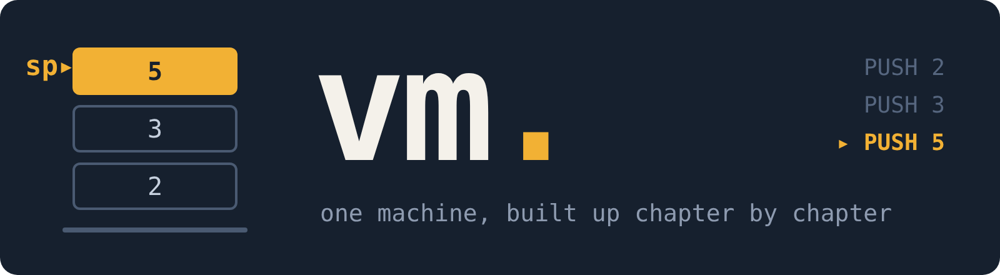

<p align="center"></p>

# Virtual Machines

*One machine, built up chapter by chapter, from forty lines of C to
compilers, garbage collection and native code.*

This repository builds a single virtual machine and keeps building
it. Each chapter is a folder with a complete, runnable machine that
is the previous chapter plus one idea. Read the chapters in order and
compare each with the one before (`diff ch02-jumps/vm.c
ch03-calls/vm.c`): the difference *is* the lesson.

It starts as simple as a virtual machine can be. It does not stay
there.

```
make test        # build and test every chapter, and the appendix
```

All you need is a C compiler, `make` and, from chapter 5 onward,
Python 3. The last two chapters need a little more: chapter 21 needs
`clang` with `wasm-ld` (the `lld` package) and Node.js, and chapter 22
needs Icarus Verilog (`iverilog`). The appendix needs only Python;
if Java is installed, its last study also checks itself against the
real JVM (GitHub). Nothing is downloaded while building.

## Background

My own journey into virtual machines began with UCSD Pascal on the
Apple II around 1980. The *p-machine* it ran on was a stack machine
much like the one in chapter 1, and it was why the same Pascal
program could run on an Apple, a PDP-11 or an IBM PC.

The words *virtual machine*, *interpreter* and *emulator* overlap a
great deal, and it is not worth getting stuck on the definitions.
What matters is the abstraction: a layer that hides the machine
below from the programs above. The Apollo Guidance Computer had one,
Busicom's calculator code on the Intel 4004 was one, and Steve
Wozniak's SWEET16 was one.


### Part I: The machine

| #  | Chapter              | Idea                                                              |
|----|----------------------|-------------------------------------------------------------------|
| 1  | [stack](ch01-stack)  | A loop, a program counter, a stack of numbers.                    |
| 2  | [jumps](ch02-jumps)  | Change `pc`, and the machine can repeat and decide.               |
| 3  | [calls](ch03-calls)  | Frames: return addresses, locals, recursion.                      |
| 4  | [traps](ch04-traps)  | Checks and errors: stack overflow, division by zero, bad opcodes. |
| 5  | [files](ch05-files)  | A bytecode file format: programs leave the C source.              |

### Part II: Tools

| #  | Chapter              | Idea                                                                                            |
|----|----------------------|-------------------------------------------------------------------------------------------------|
| 6  | [asm](ch06-asm)      | An assembler with labels, and a disassembler.                                                   |
| 7  | [trace](ch07-trace)  | Single step, trace, breakpoints, a log you can replay.                                          |
| 8  | [spec](ch08-spec)    | A written specification, a shared test suite, and a second machine in Python that must pass it. |

### Part III: Languages on the machine

| #  | Chapter                  | Idea                                                               |
|----|--------------------------|--------------------------------------------------------------------|
| 9  | [expr](ch09-expr)        | Scanner, parser, syntax tree, code generator, for arithmetic.      |
| 10 | [enkel](ch10-enkel)      | *enkel/0*, a small Pascal-like language, compiled to this machine. |
| 11 | [basal](ch11-basal)      | *basal/0*, a small BASIC, on the same machine.                     |
| 12 | [parsing](ch12-parsing)  | Other ways to parse: Pratt parsing, parser combinators.            |

### Part IV: The run-time

| #  | Chapter                    | Idea                                                            |
|----|----------------------------|-----------------------------------------------------------------|
| 13 | [heap](ch13-heap)          | Strings, arrays, records: values that do not fit on the stack.  |
| 14 | [gc](ch14-gc)              | Mark and sweep, then copying collection, measured side by side. |
| 15 | [closures](ch15-closures)  | Functions as values, and the variables they carry with them.    |

### Part V: Further

| #  | Chapter                      | Idea                                                                  |
|----|------------------------------|-----------------------------------------------------------------------|
| 16 | [dispatch](ch16-dispatch)    | `switch`, computed `goto`, threaded code: how fast can the loop go?   |
| 17 | [registers](ch17-registers)  | A register machine, and translating stack code into it.               |
| 18 | [optimise](ch18-optimise)    | Constant folding, peephole rewriting, superinstructions.              |
| 19 | [verify](ch19-verify)        | A bytecode verifier: reject bad programs before they run.             |
| 20 | [native](ch20-native)        | Compile programs to C, and from there to native code.                 |
| 21 | [wasm](ch21-wasm)            | The machine compiled to WebAssembly, and a playground in the browser. |
| 22 | [metal](ch22-metal)          | The core of the machine as hardware, in Verilog.                      |

### [Appendix](appendix): Other machines ✓

Short studies of machines that are not ours, each a small runnable
version in Python, and each showing a decision our machine made
differently.

| A-F | Study                                | Idea                                                        |
|-----|--------------------------------------|-------------------------------------------------------------|
| A   | [Metcalfe](appendix/a-metcalfe)      | A parsing machine: a flag, calls, and undoing on failure.   |
| B   | [p-code](appendix/b-pcode)           | Wirth's P-machine, ancestor of UCSD p-code: static links.   |
| C   | [CHIP-8](appendix/c-chip8)           | Registers, XOR graphics, and what no specification costs.   |
| D   | [SWEET16](appendix/d-sweet16)        | Wozniak's 16-bit machine inside 6502 code: size over speed. |
| E   | [PostScript](appendix/e-postscript)  | Dynamic names, procedures as data, pages as programs.       |
| F   | [JVM](appendix/f-jvm)                | Constant pool, typed instructions, checked before running.  |


## The instruction set

The instructions grow from chapter to chapter, but an instruction,
once added, keeps its number and its meaning. A program for chapter
2 runs unchanged on chapter 3. [`ISA.md`](ISA.md) lists all of them
and says where each first appears.


## The earlier collection

The previous version of this repository, a set of nineteen loosely
connected experiments, is kept unchanged in [`archive/`](archive).
Its ideas are being carried into the chapters above:

| Earlier             | Becomes                   |
|---------------------|---------------------------|
| vm1, vm2, vm3       | chapters 1 to 3           |
| debug               | chapters 6 and 7          |
| vm4                 | chapter 8                 |
| cmp1 to cmp4        | chapter 9                 |
| enkel0              | chapter 10                |
| basal0              | chapter 11                |
| parse, metcalfe     | chapter 12 and appendix A |
| vm5                 | chapters 13 and 14        |
| vm1/REGVM.md        | chapter 17                |
| add                 | chapters 15 and 22        |
| chip8               | appendix C                |
| ps                  | appendix E                |
| jvm1, jvm2, pitiful | appendix F                |

The basic code of the earliest machines in the archive was inspired
by Bartosz Sypytkowski's
[simple virtual machine](https://bartoszsypytkowski.com/simple-virtual-machine/).
`archive/chip8` and `archive/pitiful` are other people's code, under
their own licences.


## Warning

These machines are for reading, not for production. Things a real
implementation must do are left out when they would hide the idea a
chapter is about, and each chapter says what it leaves out.


## License

[Unlicense](UNLICENSE), except where a folder carries its own
licence.
