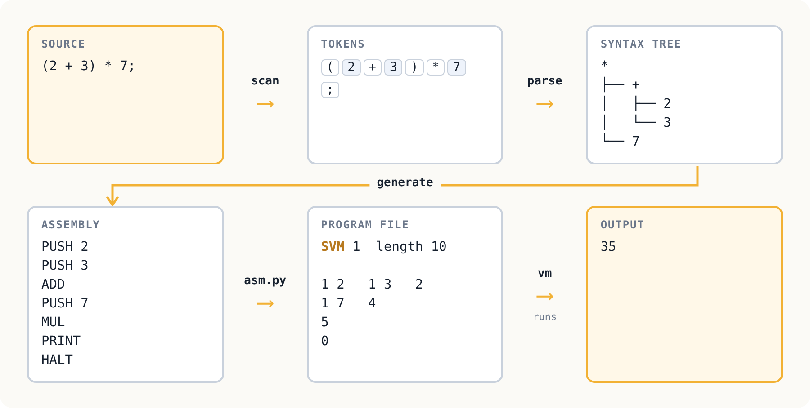

# Chapter 9: A compiler for expressions

Part III begins. Since chapter 6 we have written programs in assembly
language, one instruction at a time. Now we write them in a language
of our own, and let a compiler write the assembly.

The language is deliberately tiny: arithmetic, and nothing else.

```
(2 + 3) * 7 - 5;
-7 / 2;
```

Each expression is printed when the program runs. There are no
variables, no loops, no decisions. That is the point: with nothing
else in the way, the three stages of a compiler can be seen clearly.
Chapter 10 builds a whole language on the same three stages.

The machine is chapter 8's, unchanged.

<p align="center"></p>

## Stage 1: scanning

The *scanner* reads characters and produces *tokens*, the words of
the language. It knows what a number looks like and which characters
are operators, and it throws away spaces and comments. It knows
nothing about grammar: to the scanner, `) 3 (` is three perfectly good
tokens.

```
$ python3 expr.py -tokens samples/basics.expr
3:1  number   '1'
3:3  +        '+'
3:5  number   '2'
3:6  ;        ';'
```

Every token remembers its line and column, so that every later error
can say exactly where it is.

## Stage 2: parsing

The *parser* checks the tokens against the grammar:

```
program    = { expression ";" } .
expression = term { ("+" | "-") term } .
term       = unary { ("*" | "/" | "%") unary } .
unary      = "-" unary | factor .
factor     = number | "(" expression ")" .
```

and builds a *syntax tree*:

```
$ python3 expr.py -tree samples/basics.expr
-
├── *
│   ├── +
│   │   ├── 2
│   │   └── 3
│   └── 7
└── 5
```

The parser in [`expr.py`](expr.py) has one function per grammar rule,
and each calls the functions for the rules it mentions. This is a
*recursive descent* parser, the kind Niklaus Wirth used for PL/0 and
Pascal and the kind `archive/cmp2` began with.

Two properties of arithmetic live in the shape of the grammar, not in
any special code:

- **Precedence.** `*` binds tighter than `+` because `term`s are built
  inside `expression`s. In `2 + 3 * 7`, the `3 * 7` is finished
  before the `+` sees it.
- **Associativity.** `100 - 10 - 1` is `(100 - 10) - 1` because
  `expression` loops, adding each new term to the tree built so far.
  Written as recursion on the right instead, it would compute
  `100 - (10 - 1)`, and the tests catch exactly that mistake.

The tree has no parentheses. Once the shape is right, they have done
their job.

## Stage 3: generating code

For a stack machine, code generation is almost nothing. To compute
`left + right`: generate code for `left`, which leaves its value on
the stack; generate code for `right`, which leaves its value on top;
then `ADD`. Every node works the same way: children first, then the
node itself. This order is called *post-order*, and for a stack
machine it *is* the code generator.

Unary minus becomes `0 - x`: `PUSH 0`, the code for x, `SUB`. The
machine has no `NEG` instruction and does not need one.

## The whole pipeline

```
python3 expr.py prog.expr > prog.asm      compile
python3 asm.py prog.asm prog.vm           assemble
./vm prog.vm                              run
```

The [`Makefile`](Makefile) has rules for both steps, so
`make samples/basics.vm` does the first two.

## Errors

A compiler meets far more wrong programs than right ones, so its
error messages matter. Each says where, and shows it:

```
tests/paren.expr:2:7: expected ')', found ';'
    (3 + 4;
          ^
```

Division by zero is *not* a compile error, even in `10 / (5 - 5)`
where the compiler could know. The compiler does not evaluate
anything; the machine traps when the program runs. (Chapter 18's optimiser does
work out constant expressions, and leaves `10 / 0` alone for exactly
this reason: folding it away would remove the trap, and change what
the program does.)

## Testing with random programs

[`fuzz.py`](fuzz.py) writes 500 random expressions with as few
parentheses as the grammar allows, and works out in Python what each
must print, following the specification: 32-bit wrapping, division
rounding towards zero. The test compiles them, runs them, and
compares. A parser that gets associativity wrong fails 464 of the
500.

```
make test
```

## Exercises

1. Leave out the `;` after line 2 of a program. The error message
   points at line 3. Why? Make the message say where the `;` was
   missing instead.
2. Add `^` for powers. Powers usually associate to the *right*:
   `2 ^ 3 ^ 2` is `2 ^ 9`. Where in the grammar does it go, and why
   is right recursion now correct?
3. The scanner treats `2 3;` as two numbers, and the parser then
   rejects it. Could the scanner have caught it? Should it?
4. Count the stack depth each expression needs. Add a check to the
   compiler that refuses expressions too deep for the machine's 256
   values, before they are ever run.
