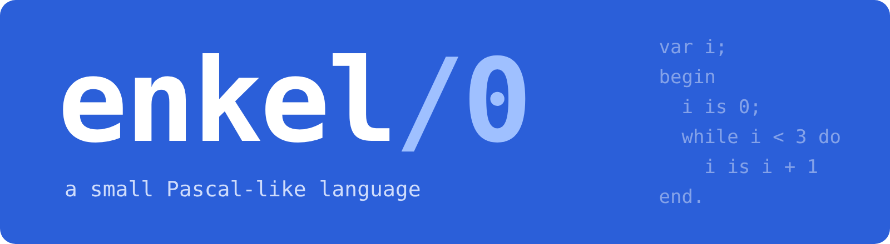

<p align="center"></p>

# Chapter 10: enkel/0

Chapter 9 compiled arithmetic. This chapter compiles a language:
variables, arrays, procedures, recursion, loops and decisions.

```
procedure gcd[a, b];
  begin
    while a # b do
      begin
        if b < a
          then a is a - b
          else b is b - a
      end;
      return a
  end;

begin
  call gcd[15, 6];
  print rval
end.
```

The language is *enkel/0*, from the earlier collection
(`archive/enkel0`), and is described in [`LANG.md`](LANG.md). All ten
of its old sample programs compile and run here, unchanged apart from
their line endings.

## Four stages

[`enkel.py`](enkel.py) has the stages of chapter 9 and one more:

| Stage | From | To | New here |
|-------|------|----|----------|
| scan | text | tokens | keywords, names, two-character symbols like `<=`, comments |
| parse | tokens | syntax tree | statements, declarations, procedures |
| **resolve** | tree | tree with meanings | everything |
| generate | tree | assembly | jumps, calls, variables |

**Resolving** is what names make necessary. The parser knows that
`x is 1` is an assignment to something called `x`. It does not know,
and cannot know, whether `x` is a local variable, a global one, a
constant that must not change, or nothing at all. Answering that
needs the declarations, and they may come later in the program: a
procedure can call one declared after it. So the resolver walks the
whole tree after parsing and gives each name its meaning:

| Meaning | Where it lives | Read with | Written with |
|---------|----------------|-----------|--------------|
| constant | nowhere: it is a number | `PUSH n` | (refused) |
| global variable | memory | `PUSH addr`, `LOADM` | `PUSH addr`, value, `STOREM` |
| array element | memory | `PUSH base`, index, `ADD`, `LOADM` | same, then `STOREM` |
| local variable | the call's frame | `LOAD k` | `STORE k` |

Most of the compiler's error messages come from this stage:

```
tests/args.p:5:10: 'add' takes 2 arguments, given 1
        call add[1]
             ^
```

## The machine grows: specification version 2

Global variables and arrays need somewhere to live that is not a
call's frame, since they outlive every call. `emit` prints
characters. And enkel/0 has `and`, `or` and `xor`. So the machine
gains, in [`SPEC.md`](SPEC.md) version 2:

| Code | Name | Effect |
|------|------|--------|
| 21 | AND | a b → a and b, bit by bit |
| 22 | OR | a b → a or b |
| 23 | XOR | a b → a xor b |
| 24 | LOADM | addr → memory[addr] |
| 25 | STOREM | addr v → ; memory[addr] = v |
| 26 | EMIT | c → ; print the byte c |

Memory is 4096 values, all zero at the start. Both machines, the C
one and the Python one, were extended, and the conformance suite grew
by nine tests for the new instructions and their traps. Everything
from version 1 still passes.

Note what the machine did *not* get: no `GT`, no `NEG`, no `NOT`, no
`NE`. The compiler builds `a > b` as `b < a` (`SWAP`, `LT`), `-x` as
`0 - x`, and `a # b` as `(a = b) = 0`. Every instruction the machine
has must be implemented, specified and tested twice; every one it
does without is free.

## What the code looks like

```
$ python3 enkel.py samples/gcd.p
...
; 5: if b < a
        LOAD 1
        LOAD 0
        LT
        JZ L3
; 6: then a is a - b
        LOAD 0
        LOAD 1
        SUB
        STORE 0
        JMP L4
L3:
...
```

Each statement is preceded by the source line it came from, so the
assembly can be read beside the program, and the tracer and debugger
of chapter 7 work on it as on any other.

The code is not clever. `return a` at the end of `gcd` is followed by
a `PUSH 0`, `RET` that can never run: the compiler always ends a
procedure that way, in case the last statement was not a `return`.
Chapter 18 deals with code like this.

## rval

In enkel/0 a call is a statement, not part of an expression, and its
result arrives in a global variable called `rval`. This is unusual,
and it was a deliberate choice: it keeps expressions simple, since
evaluating one can never call a procedure. It has a cost too. Look at
[`samples/recursive-factorial.p`](samples/recursive-factorial.p),
which works only because a procedure that ends without `return`
leaves `rval` alone, so the value set by the deepest call travels
back up. The compiler keeps exactly that rule: only `return` with a
value sets `rval`.

## A bug, thirty lines in

The old `fibonacci-dynamic.p` declared `array A:15` and wrote to
`A.15`, one element past the end. It never failed, because nothing
checked; the value went into whatever memory came next, which
happened to be unused. Here the sample says `A:16`. The compiler
catches the mistake when the index is a constant (`A.15`), but not
when it is computed (`A.i`), and the machine knows nothing about
arrays at all. Exercise 1 is about that.

## Tests

```
make test
```

- the conformance suite, version 2, on both machines, and their
  traces compared on every suite program and sample;
- every sample, against its expected output;
- 300 random expressions from chapter 9's fuzzer, written as
  `print` statements: a second compiler must agree with the first;
- twelve programs with mistakes, against their error messages.

## Exercises

1. Make array indexes safe. Either have the compiler check every
   computed index at run time (what code would it generate?), or add a
   bounds-checked instruction to the machine. Which is better, and
   for whom?
2. Let calls be expressions: `print gcd[15, 6]`. What has to change in
   the grammar, the resolver and the generator? Do you still need
   `rval`?
3. Allow procedures inside procedures, with access to the enclosing
   procedure's variables. This is what PL/0 and Pascal do, and it
   needs a *static link* in each frame. Why is the frame pointer of
   the caller not enough?
4. Add `for i is 1 to 10 do ...`. Can it be translated into a `while`
   loop in the parser, without touching the generator at all?
