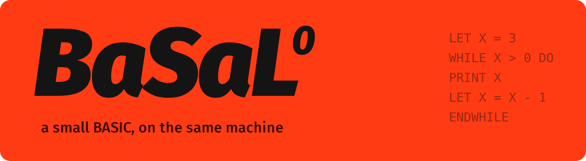

<p align="center"></p>

# Chapter 11: basal/0

A second language for the same machine. *basal/0* (Swedish for
*basic*, pronounced [bɑˈsɑːl]) is a small BASIC in the spirit of Tiny
BASIC: one statement to a line, variables that need no declaring,
`GOTO` and `GOSUB`.

```
LET a = 15
LET b = 6

WHILE a <> b DO
  IF b < a THEN
    LET a = a - b
  ELSE
    LET b = b - a
  ENDIF
ENDWHILE

PRINT a
```

The program file it compiles to runs on chapter 10's machine with no
change at all. That is the point of a virtual machine: enkel/0,
basal/0 and anything else compiled to it share one machine, one
assembler, one debugger and one specification.

## The language

```ebnf
program   = { [ statement ] NEWLINE } .
statement = "!" label
          | "LET" name "=" expression
          | "PRINT" [ ( string | expression ) [ ";" ] ]
          | "IF" condition "THEN" NEWLINE program [ "ELSE" NEWLINE program ] "ENDIF"
          | "WHILE" condition "DO" NEWLINE program "ENDWHILE"
          | "FOR" name "=" expression "TO" expression [ "STEP" [ "-" ] number ]
                NEWLINE program "NEXT" name
          | "ON" expression ( "GOTO" | "GOSUB" ) label { "," label }
          | "GOTO" label | "GOSUB" label | "RETURN" | "END" .
condition  = expression ( "=" | "<>" | "<" | "<=" | ">" | ">=" ) expression .
expression = term { ( "+" | "-" ) term } .
term       = factor { ( "*" | "/" ) factor } .
factor     = name | number | "(" expression ")" | ( "-" | "+" ) factor .
```

Keywords are in capitals; names of variables and labels are case
sensitive. `#` starts a comment. Every variable is global and starts
at 0. `PRINT x;` stays on the same line.

The old samples from `archive/basal0` run as they were, including
`hurkle.bas`, adapted from Tiny BASIC.

## No syntax tree

[`basal.py`](basal.py) is built differently from `enkel.py`, on
purpose. enkel/0's compiler parses the whole program into a tree,
resolves the names in it, and only then generates code. basal/0's
compiler builds no tree. Each parsing function writes the assembly
for what it has just recognised, the moment it has recognised it:

```python
def expression(self):
    self.term()
    while self.at("+", "-"):
        op = self.take(self.peek().kind).kind
        self.term()
        self.emit("ADD" if op == "+" else "SUB")
```

This is chapter 9's post-order code generation, folded into the
parser. It is called *syntax-directed translation*. It is how most
compilers worked when memory was too small to hold a tree, and BASIC
suits it well: a line is a statement, and a statement rarely needs to
know anything about the rest of the program.

Rarely, but not never. `GOTO DONE` can come before `! DONE`. The
compiler does not need to know where `DONE` is, since it writes a
symbolic label and leaves addresses to the assembler. But it does
need to report a label that does not exist anywhere, so it keeps a
list of the labels used and checks it at the end. Even a one-pass
compiler needs a little memory of what it has seen.

## Syntactic sugar

`FOR` and `ON ... GOTO` are not in the translator at all. A separate
stage, *desugaring*, rewrites them into simpler statements first,
working on tokens:

```
$ python3 basal.py -desugar samples/countdown.bas
LET N = 10
WHILE N >= 0 DO
PRINT N ;
PRINT " " ;
LET N = N + - 2
ENDWHILE
...
IF ( K ) = 1 THEN
GOSUB ONE
ENDIF
```

The translator has never heard of `FOR`. Anything that can be said in
the smaller language is better said there once, than handled again
in every later stage. The same idea, much grown, is how Lisp macros
and C++ templates work, and how languages like Kotlin and Swift
lower their convenient syntax into a smaller core.

The rewritten tokens keep the positions of the tokens they came from,
so an error inside a `FOR` is still reported at the `FOR`.

## A run-time library

`PRINT X;` must print a number without ending the line, and the
machine's `PRINT` always ends it. Rather than add an instruction, the
compiler adds a routine, `print_number`, written in assembly, to any
program that needs it. It prints digit by digit with `EMIT`.

It does its arithmetic on the number made *negative*. Every 32-bit
number has a negative partner, but -2147483648 has no positive one,
so a routine that made numbers positive first would fail on exactly
one value. [`samples/extremes.bas`](samples/extremes.bas) prints it.

Code that a compiler adds to programs, to provide what the machine
does not, is a *run-time library*. C's `printf` is one; this is a very
small one.

## GOSUB on a machine with frames

`GOSUB L` becomes `CALL L 0`, and `RETURN` becomes `RET`. A
subroutine is a call with no arguments and no locals. But BASIC lets
a program `GOTO` out of a subroutine, or `RETURN` without having used
`GOSUB`, and the compiler cannot see that coming, so it does not try.
The machine catches it when it runs:

```
$ ./vm tests/return.vm
before
trap: return without call at 23
```

Chapter 4's traps, doing their job for a language that did not exist
when they were written.

## Tests

```
make test
```

- every sample against its expected output,
- ten programs with mistakes against their error messages,
- `RETURN` without `GOSUB`: compiles, then traps.

## Exercises

1. Add `INPUT X`. The machine cannot read anything yet. Which
   instruction would you add, how would you specify it, and what
   should happen at the end of the input?
2. `FOR` evaluates its limit again on every round, because the
   desugared `WHILE` does. Make it evaluate the limit once. (Hint: a
   hidden variable.)
3. Add `DIM A(10)` and `A(I)` for arrays. Can it be done entirely by
   desugaring? What does the translator need to know?
4. Compile the same program, say gcd, in enkel/0 and in basal/0, and
   compare the assembly. Which is shorter? Why?
