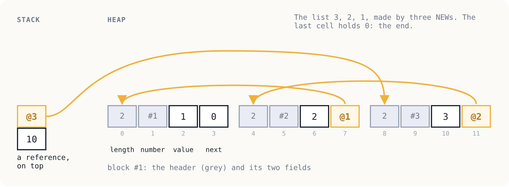

# Chapter 13: A heap

Part IV is about the *run-time*: what the machine does for a program
beyond running its instructions. It starts with memory.

So far a program has had two places to keep values. The stack holds
values for as long as a call lasts. Memory, since chapter 10, holds
4096 values for as long as the program runs. Neither fits a string
whose length is known only when the program runs, or a list that
grows, or a record made in one procedure and handed back to another.
For those a program needs a *heap*: blocks of any size, made whenever
needed, that live for as long as something refers to them.

<p align="center"></p>

## Four instructions

| Code | Name | Effect |
|------|------|--------|
| 27 | NEW | n → r: a new block of n fields, all 0 |
| 28 | GETF | r i → field i of r |
| 29 | SETF | r i v → ; field i of r = v |
| 30 | LEN | r → the number of fields of r |

A string is a block of character codes. A list cell is a block of two
fields, a value and the next cell. A record is a block whose fields
mean whatever the program says they mean. The machine does not care;
see [`samples/strings.asm`](samples/strings.asm) and
[`samples/lists.asm`](samples/lists.asm).

## Values that know what they are

This is the biggest change to the machine since chapter 1. Until now
a value was a number. Now a value is *either* an integer *or* a
reference to a block, and it carries a tag that says which:

```c
struct value {
    int is_ref;
    int n;
};
```

The tag costs memory: every value is now twice the size. It buys two
things.

**Safety.** Only `NEW` makes references. There is no instruction that
turns a number into a reference, so a program cannot point anywhere
it was not given. And `GETF` and `SETF` check every index. Remember
the sample in chapter 10 that wrote one element past the end of an
array, and nothing noticed? [`samples/bounds.asm`](samples/bounds.asm)
makes the same mistake on the heap:

```
$ ./vm samples/bounds.vm
trap: index out of bounds at 21
```

**Garbage collection.** A block that nothing refers to any more can
never be used again, and its space can be given to a new block. To
find such blocks, a collector must find every reference in the
machine, and be sure that what it found *is* a reference and not a
number that happens to look like an address. With tags, it can be
sure. That is chapter 14.

Doing arithmetic on a reference, or printing one, traps: *not a
number*. Comparing two references with `EQ` asks whether they refer
to the *same* block, not whether two blocks hold the same values.

## Seeing references

A reference has no address a program can see. In traces it is shown
by the number of its block: `@1` for the first block ever made, `@2`
for the second, and so on.

```
    32    27  NEW             | 9 @1 | 9 @1 @2
    33    28  DUP             | 9 @1 | 9 @1 @2 @2
```

This is a deliberate choice. Addresses would differ between the C
machine and the Python one, and in chapter 14 a garbage collector
will *move* blocks to new addresses while the program runs. Block
numbers never change, so traces can still be compared, line by line,
across machines and collectors.

## Specification version 3

[`SPEC.md`](SPEC.md) now says what a value is, what a block is, which
instructions accept which kind of value, and in what order everything
is checked. It also says something this chapter's machines do *not*
do:

> A block that is not reachable can never be used again, and a
> machine **must** reclaim the space it takes. ... a program that
> keeps only a small amount reachable must be able to make blocks
> forever.

The machines here never reclaim anything. Each new block goes after
the last one, until there is no room left. The suite's
[`garbage`](suite/garbage.asm) test makes 100,000 blocks and keeps
none of them, and both machines fail it:

```
FAIL garbage
./vm: 65 of 66 passed
  garbage: a known failure
```

`conform.py` now accepts `--known garbage`: a failure documented here
does not fail the build, but it is still run and still reported every
time. If it ever passes, that is reported too, since then this
documentation would be wrong. A known failure that is written down is
honest; one that is quietly skipped is not.

The Python machine needs no collector to keep its own memory in
check, since Python reclaims its `Ref` objects by itself. But it counts
heap space exactly as the C machine does, so that both run out of
memory at the same instruction and their traces still agree.

## Run it

```
make test
```

## Exercises

1. Write `concat(a, b)`, which makes a new string holding a then b.
   Then print "hello, world" with it.
2. A record for a point could be a block of two fields, x and y.
   Write a procedure that takes two points and returns their sum as a
   new point.
3. Why does `NEW` fill a new block with zeros, rather than leave
   whatever was in that space before? What could go wrong otherwise?
   (Think about the tags.)
4. Every value is now twice as big. Find a way to tag values that
   costs no extra space. (Hint: real machines often steal the lowest
   bit. What does that do to the range of integers?)
