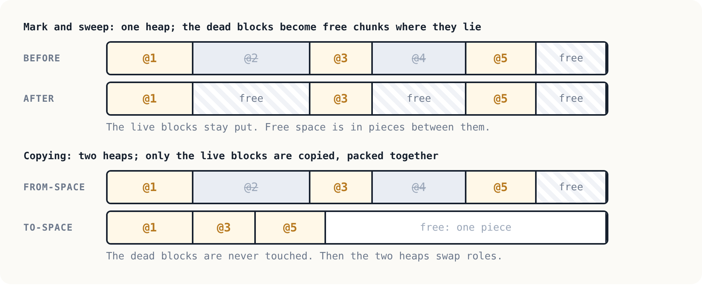

# Chapter 14: Garbage collection

Chapter 13's machine made blocks and never gave any back. Its heap
filled up after a few thousand, and it failed the one test in the
suite that asked it to go on making blocks forever while keeping
almost none. This chapter's machine passes it, with two different
garbage collectors.

```
./vm -g mark program.vm       mark and sweep (the default)
./vm -g copy program.vm       copying
```

The question both answer is the same: *which blocks can the program
still reach?* A block is reachable if a reference to it is on the
stack, in memory, or inside another reachable block. Every other
block is garbage: the program has no way to use it again, so its space
can be used for something new. Chapter 13's tags make this possible:
the collector can be sure which values are references.

<p align="center"></p>

## Mark and sweep

John McCarthy's collector for Lisp, 1960, and the one the old
`archive/vm5` began. Two phases:

1. **Mark.** Start from the *roots*, the stack and memory, and mark
   every block they refer to, then every block *those* refer to, and
   so on. The machine keeps a list of marked blocks still to look
   inside, instead of calling itself recursively, so a long linked
   list cannot overflow the C stack.
2. **Sweep.** Walk the whole heap from end to end. A marked block is
   kept (and unmarked, ready for next time). Anything else becomes
   free space, and free space next to free space is merged into one
   chunk.

New blocks come from a *free list* of chunks, by *first fit*: the
first chunk big enough. The blocks never move, which is simple, and
is also the weakness: the free space ends up in pieces between live
blocks, and a big block may not fit anywhere even when there is
enough free space in total. That is *fragmentation*.

## Copying

C. J. Cheney's algorithm, 1970. The heap is split into two halves,
and only one is used at a time. When it is full:

1. Copy every block the roots refer to into the other half, packed
   together, and leave a *forwarding address* in each old block: where
   its copy is now.
2. Go through the copies from the start. For each reference in them:
   if the block it refers to has already been copied, use the
   forwarding address; if not, copy it now, at the end. When the scan
   catches up with the end, everything reachable has been copied.
3. Swap the halves.

Garbage is never touched, not even looked at. The free space is
always one piece, so new blocks just go at the end. The cost is that
half the heap is always empty, and that every live block is copied,
every time.

## Which is better?

[`samples/trees.asm`](samples/trees.asm) is the classic benchmark:
200 short-lived binary trees, 1.6 million places allocated in a heap
of 65,536, while one long-lived tree stays alive throughout. Changing
the size of the long-lived tree:

| Long-lived tree | Collections | Mark and sweep: places freed | Copying: places copied |
|-----------------|-------------|------------------------------|------------------------|
| 8,188 places    | 28          | 1,604,848                    | 230,160                |
| 16,380 places   | 33          | 1,621,224                    | 541,464                |
| 32,764 places   | 49          | 1,604,848                    | 1,606,416              |

(From `./vm -s`, which prints these statistics on exit.)

Mark and sweep does work in proportion to the *garbage*: its sweep
frees about the same amount, however much is alive. Copying does work
in proportion to what is *alive*: with little live data it barely
works at all, and as the live data grows, its work grows with it,
until at half the heap it does as much as mark and sweep.

That is the whole trade-off, and it is why real collectors are
*generational*: most blocks die young, so copy the young ones, where
little survives, and leave the old ones, where most do, to a
collector that does not copy. The JVM, .NET and V8 all work this way.

## Testing a collector

A garbage collector that misses one root does not fail at once. It
frees a block that is still in use, the space is given to a new
block, and much later the program reads something that makes no
sense. In the meantime most tests pass, since in a small program a
collection may never even happen.

So the machine has a *stress mode*, `-S`: collect before every single
`NEW`. Under copying, that means every live block moves every time,
and a reference the collector failed to update is found at once.

To check that this works, the copying collector was broken on
purpose, by leaving out the loop that updates references in memory.
Without stress, it passed all 66 tests. With stress:

```
FAIL heap-places
  expected: '7\n7\n1\nstatus 0\n'
  got:      '7\nstatus 1\ntrap: not a number at 36\n'
./badgc -g copy -S: 65 of 66 passed
```

The test suite runs both collectors with and without stress.

## Invisible, and proved so

A collector must change nothing that a program can see. Traces show
blocks by number, not by address, so they can say so precisely: the
test compares the trace of every suite program under mark and sweep
against copying with stress, copying against mark and sweep with
stress, and the C machine against the Python one. Every step, every
stack, must be the same. They are.

The Python machine has no collector of its own: Python frees its
`Ref` objects by itself. But when its count says the heap is full, it
counts what is still reachable, which is what the C machine's
collectors would find, so it runs out of memory at exactly the same
instruction.

## Run it

```
make test
```

## Exercises

1. Add *next fit* to the mark and sweep allocator: start each search
   where the last one ended. Does it make `trees` faster or slower?
2. Write a program that makes mark and sweep run out of memory while
   copying, with the same amount of live data, does not. (Think about
   fragmentation.)
3. The mark phase looks at all 4096 words of memory on every
   collection, even in a program that uses none of it. How could the
   machine avoid that?
4. Make the copying collector *generational*: a small nursery for new
   blocks, copied often, and an old space, collected rarely. What
   happens when an old block is changed to refer to a young one? (This
   is the *write barrier*, and it is the hard part.)
