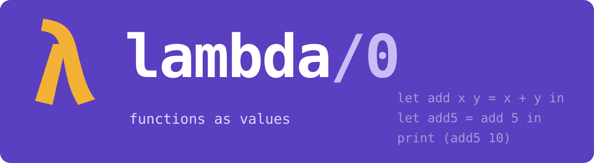

<p align="center"></p>

# Chapter 15: Closures

The last chapter of Part IV puts the heap and the garbage collector to
work for a new kind of language, one where functions are values:

```
let add x y = x + y in
let add5 = add 5 in          # add, with x fixed at 5
print (add5 10);             # 15

let twice f x = f (f x) in
print (twice add5 0)         # 10
```

`add5` is a function that did not exist when the program was written.
It was *made*, while the program ran, out of `add` and the number 5.
`twice` takes a function as its argument. Neither enkel/0 nor basal/0
can do either of these things. A procedure there is a fixed place in
the code, and the only thing to do with it is call it.

## The language: lambda/0

A small functional language in the style of ML, compiled by
[`lambda.py`](lambda.py):

- everything is an expression with a value;
- `let x = e in body` binds a name, which never changes;
- `fun x -> e` is a function, and `let f x = e` is short for
  `let f = fun x -> e`;
- `let rec` lets a function call itself;
- `if c then a else b`, arithmetic, comparisons, and `print e`.

Every function takes exactly one argument. `fun x y -> e` is short for
`fun x -> fun y -> e`, and `add 5 10` means `(add 5) 10`: `add` given 5
returns a function that is waiting for the second number. This is
*currying*, and it means a function can never be called with the
wrong number of arguments: there is only ever one.

## What a closure is

`fun x -> x + n` uses `n`, which is not its own argument. If the
function is called after the `let` that bound `n` has finished, where
does `n` come from? The function must have taken it along. So a
function value is not just the address of its code, but a block on
the heap:

```
field 0        the address of the code
field 1 ...    the values of the variables it uses from outside
```

That block is a *closure*: the code, closed over its free variables.

```
; let addn = fun x -> x + n
        PUSH 2
        NEW                     ; a block of two fields
        DUP
        PUSH 0
        PUSH fun_1
        SETF                    ; field 0: the address of the code
        DUP
        PUSH 1
        LOAD 0
        SETF                    ; field 1: the value of n, now
```

The code itself finds its argument as local 1, and the closure it
was called through as local 0, so `n` is field 1 of local 0:

```
; fun x -> ..., capturing: n
fun_1:  LOAD 1                  ; x
        LOAD 0
        PUSH 1
        GETF                    ; n, from the closure
        ADD
        RET
```

## Closure conversion

Working out which variables each function must capture is *closure
conversion*, and it is the new stage in this compiler. A variable is
*free* in an expression if the expression uses it without binding it.
`free()` in `lambda.py` computes it in a dozen lines, one rule per
kind of expression. The free variables of `fun x -> x + n` are `{n}`.

The values are *copied* into the closure when it is made. In
[`samples/closures.lam`](samples/closures.lam), `addn` keeps the `n`
it saw, even after a new `n` is bound. Since lambda/0 variables never
change, copying is safe. In a language whose variables can change,
two closures that share a variable must share one copy of it, and it
must live on the heap. That is how JavaScript and Python do it.

A function that calls itself, `let rec fact n = ... fact (n - 1)`,
has itself as a free variable. Its closure is made first, and then a
reference to the closure is stored in one of its own fields.

## One new instruction

To call a closure, the machine must jump to an address that is not in
the code, but in a value on the stack. That is `CALLI n`, for *call
indirect*: the address is popped from the stack, then everything
happens as for `CALL`. It is code 31, and the whole of version 4 of
[`SPEC.md`](SPEC.md). A call `f a` is:

```
        (f)                     ; the closure
        (a)                     ; the argument
        OVER
        PUSH 0
        GETF                    ; field 0 of the closure: the address
        CALLI 2                 ; locals 0 and 1: the closure and a
```

The assembler can now write `PUSH fun_1`, pushing the address of a
label as a number. A function pointer, in C's terms.

## Safety, from the tags

lambda/0 has no types to check before running. The machine checks as
it goes. Calling a number does `GETF` on something that is not a
block; printing a function asks `PRINT` for a number and gets a
reference:

```
$ ./vm tests/callnumber.vm
trap: not a reference at 9
$ ./vm tests/printfun.vm
trap: not a number at 12
```

Chapter 13's tags were added for the garbage collector. They also
make the machine safe for a language that checks nothing itself.

## Garbage, at last

Every `fun`, and every partial application, makes a block. Most are
needed for a moment. [`samples/garbage.lam`](samples/garbage.lam)
makes about 65,000 closures, and keeps fewer than 80 places' worth at
any time:

```
$ ./vm -g copy -s samples/garbage.vm
16384
gc: 65569 blocks made, 262305 places in all
gc: 4 collections, most live after one: 79 places
gc: 316 places copied
```

This is the program chapter 14's copying collector was made for:
nearly everything dies young.

## Data from nothing but functions

[`samples/data.lam`](samples/data.lam) builds pairs and lists using
only functions. A pair is a function that hands its two parts to
whatever it is given; a list is a function that folds its elements.
Alonzo Church showed in the 1930s that functions alone are enough
for any data, and here it runs on a stack machine.

## A limit: 256 frames

lambda/0 has no loops. Repetition is recursion, and every call takes
a frame and a few values on a stack of 256. Folding a list of 100
elements runs out. The samples stay small; `garbage.lam` repeats a
quarter of a million times only by *doubling* (`power k f` applies `f`
2ᵏ times while nesting k calls deep).

Real functional languages handle this with *tail calls*: when the
last thing a function does is call another, the new call can reuse
the old frame instead of taking a new one, and a loop written as
recursion runs in constant space. That is exercise 1.

## Run it

```
make test
```

## Exercises

1. Add `TAILCALLI n` to the machine: like `CALLI`, but it replaces the
   current frame instead of adding one. Specify it, implement it in
   both machines, and make the compiler use it for calls in tail
   position. Then count to a million.
2. Let functions take several arguments at once, without currying.
   What must a call check now, and where?
3. Add `let rec ... and ...` for two functions that call each other.
   Each closure must hold the other. In what order are they made?
4. A closure for `fun x -> x + 1` captures nothing, yet the compiler
   makes a new block every time the `fun` is evaluated. Make the
   compiler build such closures only once. Where can it keep them?
