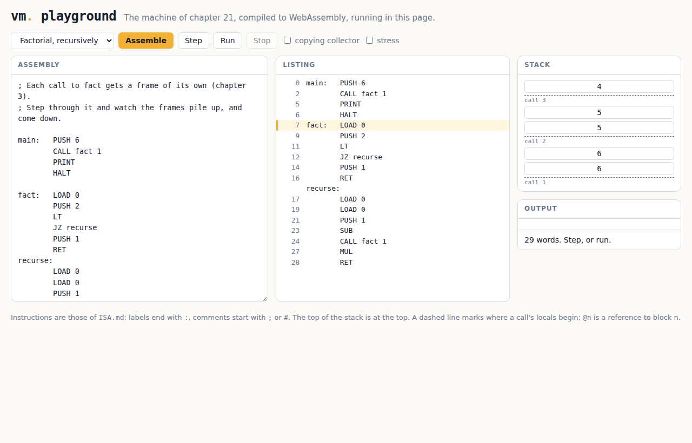

# Chapter 21: The machine in a browser

A virtual machine is a promise that a program will run the same
everywhere the machine does. This chapter takes the promise to its
widest reach: a web browser, on any computer or phone, with nothing
installed.

<p align="center"></p>

## A machine with no operating system

Every machine so far has been a C program that uses the C library:
`printf` to print, `malloc` for memory, `exit` to stop, `fopen` to
read the program. A browser has none of those. So
[`core.c`](core.c) is chapter 16's machine with all of it taken out.
It uses no library at all, and everything it needs from outside goes
through two functions that whoever runs it must provide:

```c
void host_write(int c);                  /* write one byte of output */
void host_trap(const char *why, int at); /* report a trap; never returns */
```

The host gives the machine a program by writing the bytes of a `.vm`
file into a buffer and calling `vm_load()`. Then `vm_step()` runs one
instruction and `vm_run()` runs to the end. A few more functions let a
debugger look inside: the program counter, the stack, the frames.

That is the *embedding* interface, the same idea as Lua's, which is
why Lua runs inside so many games and editors: the machine makes no
assumption about what it is running in.

## Two hosts

[`host.c`](host.c) is an ordinary C program: `host_write` is
`putchar`, `host_trap` is `fprintf` and `exit`. Built with it, the core
is a command like every earlier machine, and passes the conformance
suite. That checks the core, before anything else is involved.

The second host is JavaScript. `clang` compiles the same core to
WebAssembly, with no C library at all:

```
clang --target=wasm32 -nostdlib -Wl,--no-entry -o web/vm.wasm core.c
```

The result, [`web/vm.wasm`](web/vm.wasm), is 11.7 KB. It imports
exactly two functions, `host_write` and `host_trap`, and
[`web/machine.js`](web/machine.js) provides them. A trap becomes a
JavaScript exception that unwinds out of the WebAssembly code.

Two details of going without a library. A C compiler may turn a loop
that copies memory into a call to `memcpy`, even if the program never
names it, so `core.c` brings its own. And `PRINT` must write numbers
without `printf`, so `write_number` does it digit by digit, carefully,
since `-2147483648` has no positive partner.

## The fourth machine

[`run.mjs`](run.mjs) runs a `.vm` file on the WebAssembly machine under
Node.js, as a command. Then the conformance suite of chapter 8 can test
it like any other machine:

```
./vm: 71 of 71 passed                       (the core, with a C host)
node run.mjs: 71 of 71 passed               (the core, as WebAssembly)
node run.mjs -g copy -S: 71 of 71 passed
```

The C machine, the Python machine of chapter 8, the native code of
chapter 20, and now WebAssembly in a JavaScript engine: four very
different ways of running a program, held to one specification by one
set of tests.

## The playground

[`web/index.html`](web/index.html) is a page for writing and running
programs. Choose an example or write assembly language, then assemble
it, run it, or step through it one instruction at a time and watch
the stack: each call's locals begin at a dashed line, and references
to heap blocks show as `@n`, as in the traces of chapter 7. A trap
shows where it happened, in the listing.

The assembler is [`web/asm.js`](web/asm.js), chapter 6's `asm.py` in
JavaScript. [`test-asm.mjs`](test-asm.mjs) checks that it makes
exactly the same bytes as `asm.py` for every program in the suite.

`web/index.html` must be served over HTTP (`make serve`, then open
<http://localhost:8000>), since a browser will not fetch `vm.wasm` for
a page opened from a file. [`bundle.py`](bundle.py) makes
[`web/playground.html`](web/playground.html), one 36 KB file with the
scripts and the machine written into it, which opens straight from
disk.

## Run it

```
make test
make serve
```

`make` needs `clang` with the WebAssembly target and `wasm-ld` (on
Debian and Ubuntu, the `lld` package), and Node.js for the tests.
`web/vm.wasm` and `web/playground.html` are kept in the repository,
built, so that the playground works without building anything.

## Exercises

1. Add a *breakpoint* to the playground: click a line of the listing,
   and running stops there.
2. Add the compilers to the page. enkel/0's compiler is Python; either
   port it to JavaScript, or run Python itself in the browser with
   Pyodide. Which is better for the reader?
3. Make `run()` in the page give the browser back control every few
   milliseconds instead of every 200,000 instructions. What does it
   cost?
4. Compile `core.c` with `-O0`, `-O2` and `-Os`, and compare the size
   of `vm.wasm` and the speed of `bench/loop` from chapter 16 under
   Node.js. Then compare with the native machine. How close does
   WebAssembly get?
