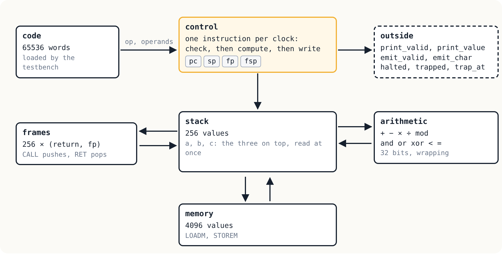

# Chapter 22: The machine as hardware

Every machine in this book has been a program, running on a processor
that someone else designed. The last chapter removes that layer: the
stack machine as a circuit, described in Verilog, the language chip
designers use, and run in a simulator, cycle by cycle.

<p align="center"></p>

## A CPU in one page

[`cpu.v`](cpu.v) implements version 2 of the specification:
instructions 0 to 26, with frames, memory, `EMIT`, and every trap. The
heap of version 3 and `CALLI` of version 4 are not here. A garbage
collector in hardware is a project of its own (Lisp machines of the
1980s had one), so codes 27 and above are unknown instructions, as
they were in version 2.

One instruction runs on each rising edge of the clock. Everything it
needs is read at once: its opcode and operands from code memory, and
the three values on top of the stack, called `a`, `b` and `c`. Then
everything it changes is written together at the end of the cycle.
Here is `ADD`, beside the C of chapter 16:

```verilog
ADD, SUB, MUL, AND, OR, XOR, LT, EQ, DIV, MOD:
    if (room < 2) stop(T_UNDERFLOW);
    else if ((op == DIV || op == MOD) && c == 0) stop(T_DIVZERO);
    else begin
        case (op)
        ADD: stack[sp - 2] <= b + c;
        ...
        endcase
        sp <= sp - 1;
        pc <= pc + 1;
    end
```

```c
OP(ADD) {
    struct value w = pop(), v = pop();
    push_int(wrap_add(number(v), number(w)));
    NEXT;
}
```

The C does it step by step: pop, pop, add, push. The hardware does it
all at once: it checks that the frame has two values, writes the sum
over the lower one, and moves `sp` down by one, all on the same edge
of the clock. And 32-bit wrapping arithmetic, which the C machine
needed `to_int` and unsigned arithmetic to get right, is simply what a
32-bit adder does.

Verilog's arithmetic matched the specification without help, and that
was checked before writing the CPU, not assumed: `-2147483648 / -1`
wraps to `-2147483648`, division rounds towards zero, and the
remainder takes the sign of the dividend.

## Talking to the outside

A circuit has no `printf`. The CPU has output *signals* instead. When
`PRINT` runs, `print_valid` is 1 for one cycle, with the number on
`print_value`; `EMIT` does the same with `emit_valid` and `emit_char`.
When the machine stops, `halted` or `trapped` goes to 1 and stays so,
with `trap_reason` and `trap_at`. On a real board, these would drive a
serial port or a display. In simulation, the testbench
[`tb.v`](tb.v) watches them and writes what they say.

[`vrun.py`](vrun.py) wraps the simulation as a command, like every
machine before it: it checks the `.vm` file, writes it out as
hexadecimal for the testbench, runs the simulation, and turns the end
of it into the right messages and exit status.

## The fifth machine

So the conformance suite can test the hardware:

```
python3 vrun.py: 49 of 71 passed
  calli: a known failure
  garbage: a known failure
  ... (22 known failures)
```

The 49 that pass are every test of versions 1 and 2, including the
order of the checks, the exact limits of 256 values and 256 frames, and
all the arithmetic edge cases. The 22 known failures are exactly the
tests that use the heap or `CALLI`. The `Makefile` finds them by looking
at what each test contains, so the list cannot drift.

Real programs run too. Programs compiled by the enkel/0 and basal/0
compilers of chapters 10 and 11 run on the simulated CPU and print
exactly what they print on the C machine, in one clock cycle per
instruction (plus one, at the end, to see that it stopped):

| Program | Cycles |
|---------|------:|
| enkel-hanoi | 803 |
| enkel-bubble-sort | 2,264 |
| enkel-sieve | 9,142 |
| basal-table | 5,949 |
| fib(20) | 218,911 |

A simulator is slow: about 150,000 cycles a second here. On an FPGA
running at, say, 50 MHz, `fib(20)` would take 4.4 milliseconds. But
that is arithmetic, not a measurement: this design has **not** been built
for a real chip, and its single-cycle structure, with a whole divider
in one cycle, would limit how fast its clock could go.

## The end of the road

The book began with a loop in C that fetched an instruction, looked
at it, and did what it said. It ends with the same loop as a circuit,
where fetching, looking and doing all happen at once, on the edge of a
clock. In between, the same machine was written in C, in Python, as
threaded code, as registers, as native code, as WebAssembly, and now
as hardware. Each was held to one specification by one set of tests.
That, more than any single machine, is what this book was about.

## Run it

```
make test
python3 asm.py samples/fib.asm fib.vm && python3 vrun.py -c fib.vm
```

`make` needs Icarus Verilog (`iverilog` and `vvp`; on Debian and
Ubuntu, the `iverilog` package).

## Exercises

1. Add `NEW`, `GETF`, `SETF` and `LEN` with a heap that is never
   collected, as in chapter 13. What must change in the stack, now that
   a value needs a tag?
2. Split each instruction into two stages, *fetch* and *execute*, and
   overlap them: while one instruction executes, the next is fetched.
   What happens at a jump?
3. Synthesize `cpu.v` for an FPGA with Yosys (`yosys -p "synth_ice40"`)
   and look at how big the divider is. Replace `/` and `%` with a
   divider that takes 32 cycles. What does `DIV` cost now?
4. Write a test that runs the same program on the C machine and on the
   CPU, and compares the stack after every instruction, as `compare.py`
   compared traces in chapter 8.
